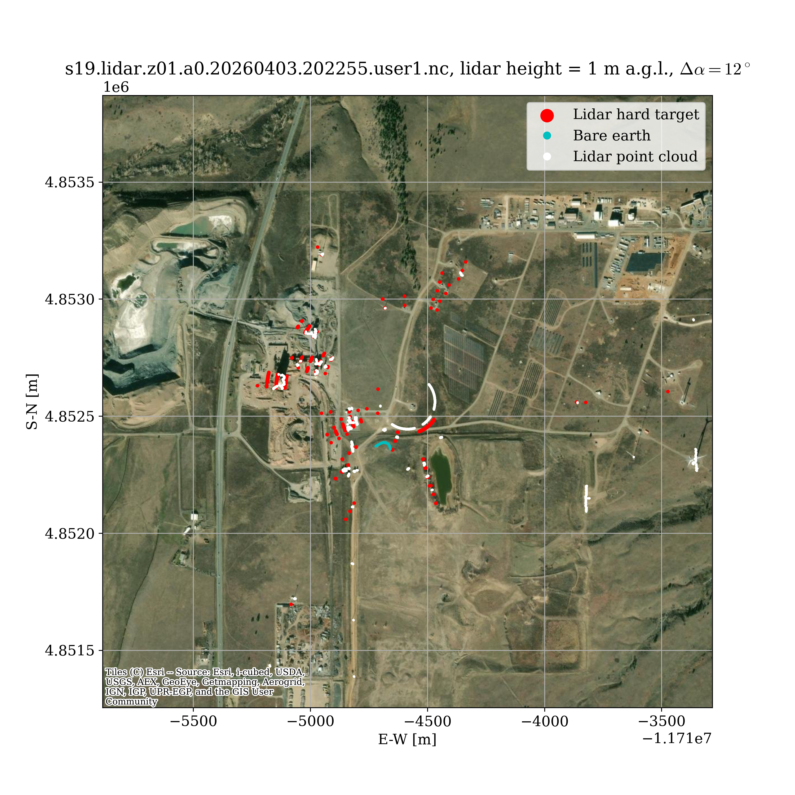
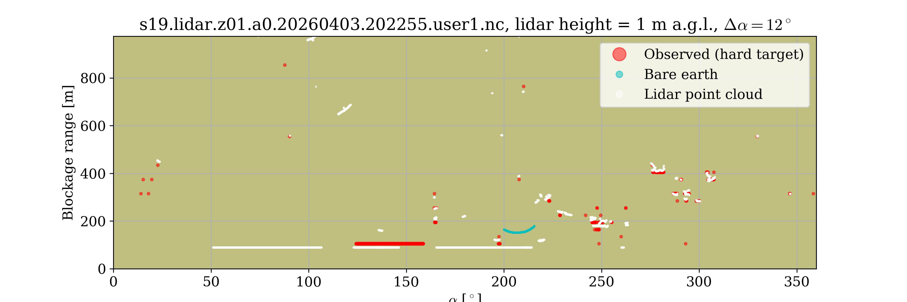
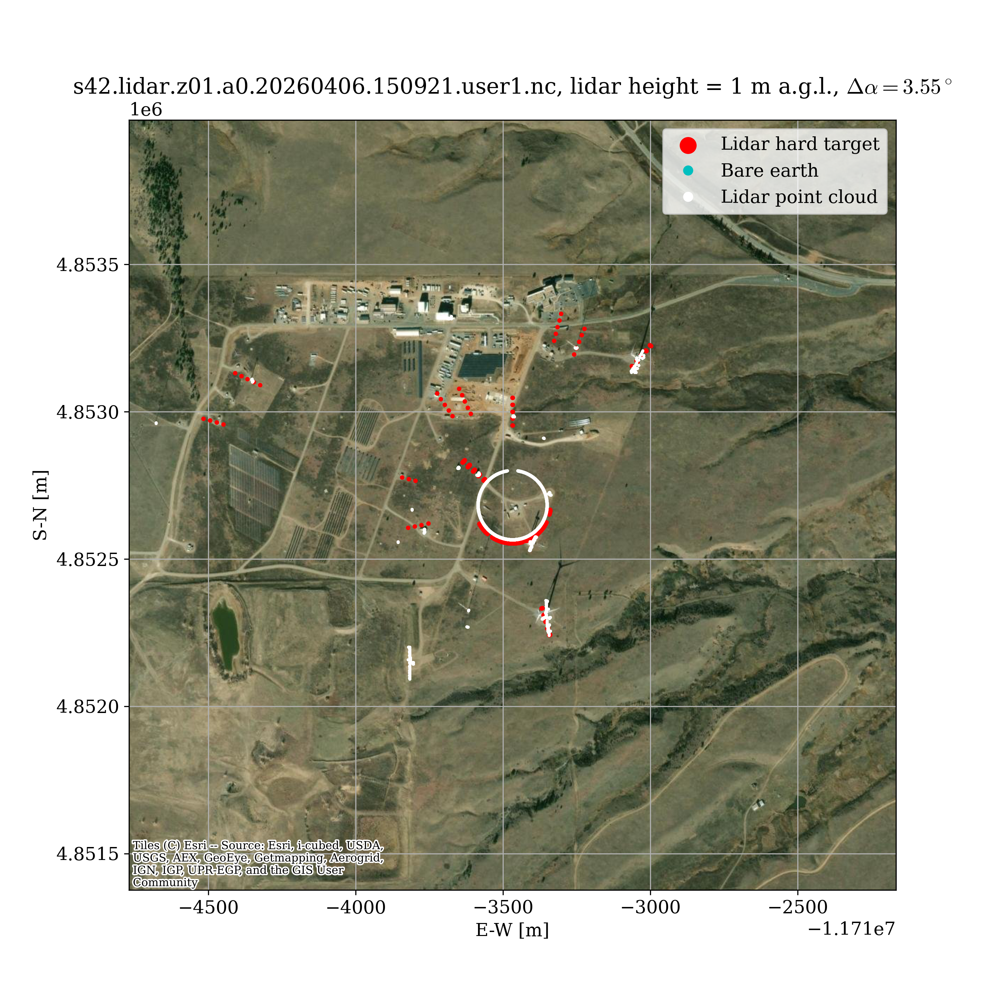
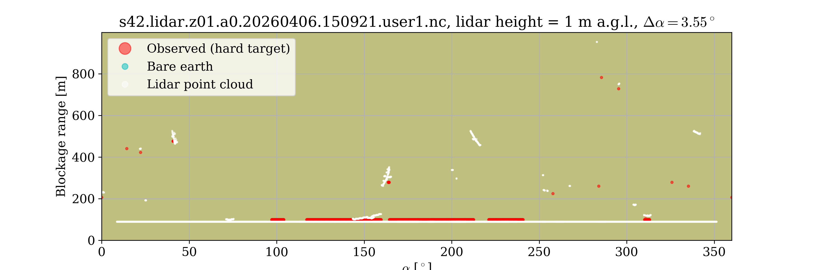

# Hard-target validation of the lidar line-of-sight blockage model

Script: `plot_hard_target.py`

## Goal

Check whether a ray-traced line-of-sight model can predict where the CORSAIR scanning lidars are blocked by terrain and obstacles. The prediction is tested against hard targets detected in the lidar data. If the model is good enough, it can be used to screen candidate sites and scan sectors before deployment.

Two surface models are tested:

- **Bare earth**: AWS Terrarium elevation tiles (zoom 14), ground only.
- **Lidar point cloud**: digital surface model (DSM) from airborne lidar (`make_dsm.py` output), which includes buildings, turbines, vegetation and other structures. Where the DSM has no data, bare earth is used.

## Data

| File | Lidar | Home azimuth offset |
|---|---|---|
| `s19.lidar.z01.a0.20260403.202255.user1.nc` | Halo 200 | 12° |
| `s42.lidar.z01.a0.20260406.150921.user1.nc` | Halo 199 | 3.55° |

Both files are PPI scans covering the full 360°. They are cropped to 1 km range, which matches the extent of the maps.

## Method

The unit of verification is a single **beam**, meaning one time stamp of the scan.

### Observed blockage (lidar)

1. **Blind zone**: gates closer than `min_r` are discarded.
2. **Hard-target candidates** are runs of consecutive gates with SNR > `min_SNR`.
3. **Validity check**: a candidate is kept only if the radial wind speed (RWS) in the low-SNR gates behind it, up to the next high-SNR run or the end of the beam, has a standard deviation > `min_rws_std_bloc`. Behind a real obstacle there is no aerosol return, so the RWS is noise. At least two valid RWS samples are needed behind the candidate.
4. **Blocked beams**: a beam is also counted as blocked when, within `max_range_bloc`, the RWS standard deviation is ≥ `min_rws_std_bloc` and the mean SNR is ≤ `max_SNR_bloc`. Such a beam is blocked right at the lidar, so it is flagged at the first gate beyond `min_r`.
5. **Observed blockage range** `r_obs`: the first valid hard target along the beam. The lidar cannot see beyond it.

### Predicted blockage (model)

Each beam is traced along slant range `s` in steps of `ds`. The beam centerline height is

```
z_beam(s) = z_ground(lidar) + lidar_height + s·sin(ele) + s²/(2·R_eff),   R_eff = 4/3·R_earth
```

[Doviak and Zrnic, 1993]. The surface is sampled along the ground track at horizontal distance `s·cos(ele)`.

- **Predicted blockages**: every point where the beam goes from above the surface to below it. A single beam can therefore be blocked several times. A near obstacle does not hide a farther one that the lidar might detect.
- **Blind zone**: blockages closer than `min_r` are placed at `min_r`, where the lidar would first see them.

### Contingency table

| | Observed blocked | Observed clear |
|---|---|---|
| **Predicted blocked** | hit | false alarm |
| **Predicted clear** | miss | correct negative |

- **Hit**: the beam is blocked in the observations, and at least one predicted blockage is within `range_tol` of `r_obs`.
- **Range mismatch**: if both the observations and the model call the beam blocked but no predicted blockage is within `range_tol`, the beam counts as **both a miss and a false alarm** ("double penalty" [Ebert, 2008]). Because of this, the four cells can add up to slightly more than the number of beams.
- **Scores** [Wilks, 2011]:
  - probability of detection: POD = hits / (hits + misses)
  - false alarm ratio: FAR = false alarms / (hits + false alarms)
  - accuracy: (hits + correct negatives) / number of beams

## Parameters

| Parameter | Value | Meaning |
|---|---|---|
| `min_SNR` | 10 dB | SNR threshold for a hard-target candidate |
| `min_rws_std_bloc` | 15 m/s | RWS standard deviation indicating noise only (validity check and blocked beams) |
| `max_SNR_bloc` | −25 dB | maximum mean near-range SNR for a blocked beam |
| `max_range_bloc` | 500 m | near-range window for the blocked-beam test |
| `min_r` | 90 m | blind zone |
| `range_tol` | 100 m | maximum \|predicted − observed\| range for a hit |
| `lidar_height` | 1 m | beam origin above ground |
| `ds` | 2 m | ray sampling step |
| `r_excl` | 0 m | surface ignored around the lidar |

## Results

### Skill scores

| File | Model | Hits | Misses | False alarms | Correct neg. | POD | FAR | Accuracy |
|---|---|---|---|---|---|---|---|---|
| s19 (Halo 200) | Bare earth | 0 | 531 | 157 | 2914 | 0.00 | 1.00 | 0.81 |
| s19 (Halo 200) | Lidar point cloud | 399 | 132 | 1432 | 1640 | 0.75 | 0.78 | 0.57 |
| s42 (Halo 199) | Bare earth | 0 | 1175 | 0 | 2425 | 0.00 | – | 0.67 |
| s42 (Halo 199) | Lidar point cloud | 1168 | 7 | 2273 | 158 | 0.99 | 0.66 | 0.37 |

### s19 (Halo 200)




- **Bare earth** predicts only one terrain blockage, an arc at about 150–180 m between 200° and 215°, which the lidar does not see. It detects none of the observed hard targets.
- **Lidar point cloud**: in the western sector (≈ 240–310°), the predicted and observed blockages coincide on the structures at 150–450 m. Further matches are at ≈ 15–25° and ≈ 165°.
- **False alarms** come mostly from predicted blockages at the edge of the blind zone (90 m) over 50–107°, 123–147° and 165–215°, where the lidar sees clear air. The near-range blocked sector observed at 124–159° (105 m) is matched by the model only over 124–147°.

### s42 (Halo 199)




- **Bare earth** predicts no blockage at all within 1 km.
- **Lidar point cloud** predicts a blockage at the edge of the blind zone at almost every azimuth (8–352°), the white ring on the map. Most observed blocked beams are near-range blockages in the southern sectors (≈ 97–105°, 117–241°, 310–313°). These fall within `range_tol` of that ring, which explains POD = 0.99. The same ring produces the 2273 false alarms in the sectors where the lidar sees clear air.
- **Farther targets**: the model reproduces the turbine at ≈ 40° (≈ 480 m) and the obstacle at ≈ 165° (≈ 280 m). It also predicts several targets the lidar did not detect, for example a structure at ≈ 210° (450–520 m) and at ≈ 340° (≈ 520 m).

### RWS and SNR fields

The radial wind speed and SNR fields, with the valid hard targets overlaid, are kept for inspection:

- [s19 RWS/SNR](../figures/hard_target/s19.lidar.z01.a0.20260403.202255.user1_rws_snr.png)
- [s42 RWS/SNR](../figures/hard_target/s42.lidar.z01.a0.20260406.150921.user1_rws_snr.png)

## Discussion

1. **Bare earth cannot predict blockage at these sites.** Within 1 km the terrain does not intercept the beam. The observed hard targets are buildings, turbines, towers and other structures, which only the point-cloud surface contains.
2. **The point-cloud model captures the far obstacles but over-predicts in the near field.** Its high POD is driven by near-range blockages, which the model matches only coarsely: anything closer than 90 m is placed at `min_r` and compared within 100 m. The ring of predicted blockages around the lidar is likely caused by near-lidar features in the DSM (trailer, vehicles, vegetation, DSM gridding) together with the low beam origin (1 m) and `r_excl = 0`. These are the dominant source of false alarms.
3. **The scores are lenient.** Because a hit needs only one predicted blockage within `range_tol`, beams that cross many surface features have several chances to score a hit.
4. **The skill scores are not yet a fair summary of model quality.** The near-field behavior dominates the counts. The far-field agreement in the maps and azimuth plots is currently the more informative result.

## References

- Doviak, R. J., and Zrnic, D. S., 1993: *Doppler Radar and Weather Observations*, 2nd ed., Academic Press.
- Ebert, E. E., 2008: Fuzzy verification of high-resolution gridded forecasts: a review and proposed framework. *Meteorol. Appl.*, 15, 51–64, doi:10.1002/met.25.
- Wilks, D. S., 2011: *Statistical Methods in the Atmospheric Sciences*, 3rd ed., Academic Press.
